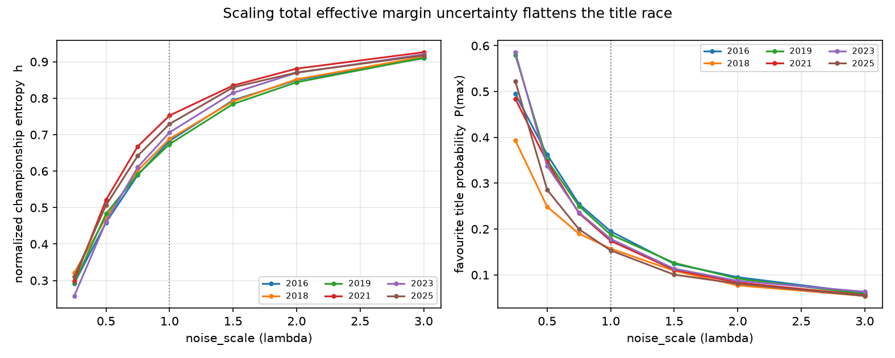
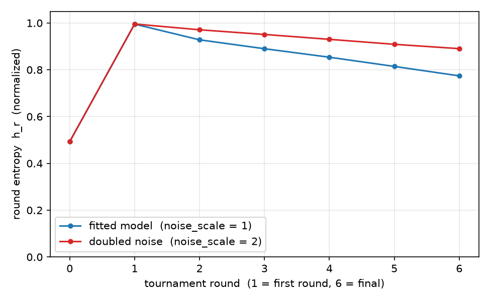

# march-madness-predictor

Simulate the men's NCAA tournament and come out with *probabilities*, not just
picks.

**Status: work in progress.** The core pipeline (fit -> simulate -> backtest)
runs and is tested, but the modelling and the analysis are still being
developed.

## Goal

A bracket pool rewards picking winners; a sportsbook, a seeding study or any
serious "how good is this team" question needs `P(team X wins it all)`. The
goal here is a model whose probabilities are actually *calibrated* - when it
says 70%, the team should win about 70% of the time - and a backtest rigorous
enough to tell whether that is true.

The thermodynamics framing is the organising idea: each team is a particle with
a small vector of end-of-season state variables, and tournament outcomes are
sampled from that state rather than hand-tuned.

## How it works

1. **Ingest** (`src/data_loader.py`) - read Kaggle's regular-season results and
   build each team's state: a sequential Elo rating, three-point attempt rate
   (`p3ar`), and variance of per-game offensive efficiency.
2. **Fit** (`src/calibration.py`) - a dyadic ridge regression on game margins,
   anchored to the Elo ratings, that estimates relative team strengths, the
   Elo-to-points conversion, home-court advantage, and a per-team score
   volatility `sigma_i = sigma_0 + alpha*z_p3ar + beta*z_effvar`.
3. **Match up** (`src/matchup.py`) - a Gaussian margin model gives
   `P(i beats j) = Phi((Elo_i - Elo_j + HCA) / (elo_per_point * tau_ij))`,
   where `tau_ij` combines both teams' volatilities. A latent strength offset is
   drawn once per team per tournament, so a hot or cold run spans the whole
   bracket instead of resetting every game.
4. **Simulate** (`src/bracket.py`, `src/simulate.py`) - the bracket graph comes
   from Kaggle's seeds/slots files, then Monte Carlo plays it out many times
   and aggregates title and per-round probabilities plus the ensemble
   observables described below.
5. **Score** (`src/backtest.py`, `tools/backtest.py`) - walk-forward backtest:
   each evaluation season is predicted using only earlier seasons, then scored
   with log loss and Brier against their trivial baselines, plus reliability
   tables.

## Ensemble observables

Beyond picking winners, `SimulationResult` reports summary statistics of the
*simulated ensemble* - they describe the shape of the model's title
distribution, not how good the forecast is (that is the backtest's job, via
log loss and Brier).

- **Championship entropy** - Shannon entropy of the title distribution,
  `H = -sum_i P_i ln P_i`, in nats. It is zero when one team wins every
  simulation and `ln F` when the title is spread evenly over the whole field.
  The normalized version `h = H / ln F` sits in `[0, 1]`: low means the model
  sees a few clear contenders, high means the title looks wide open.
- **Concentration** - the same picture in different units. `P(max)` is the
  favourite's title probability, `P(top 3)` the three front-runners summed,
  `C = sum_i P_i^2` the Herfindahl index (from `1/F` for an even field to 1
  for a certain champion), and `N_eff = 1/C` the effective number of
  contenders - how many teams would have to share the title evenly to produce
  the same concentration. A settled championship has low entropy and high
  concentration; an open one the reverse.
- **Round entropy** - the entropy of the marginal distribution over which
  teams are present at the start of each round, normalized by `ln F`. The
  first round sits at 1 (everyone plays), and later rounds fall as the field
  narrows toward the finalists. It is a per-round marginal - the uncertainty
  about who is still alive - not the entropy of whole tournament paths.

Monte Carlo error: each run is split into independent batches (20 by default)
and the standard error of every observable is the batch-to-batch spread
divided by `sqrt(n_batches)`, reported as `value +/- se` at the end of
`SimulationResult.summary()`. The batching only *counts* - it never draws
random numbers - so simulated results are identical for any batch count.

`SimulationResult.observables()` returns everything as a dict
(`H_champ`, `h_champ`, `P_max`, `P_top3`, `C`, `N_eff`, `H_r{N}`, `h_r{N}`),
and `SimulationResult.standard_errors()` returns their standard errors.

## Results

Two questions: are the probabilities *right* (backtest), and how does the
model's uncertainty behave under the effective-noise knob (sweep)?

### Backtest (walk-forward, 2021-2025)

Each season is predicted from earlier seasons only; nothing from the
evaluation season enters the fit.  Four seasons scored (2021 is skipped: the
source file has a game-count defect), 4,000 sims each, seed 0.

| metric | model | trivial baseline | better by |
| --- | ---: | ---: | ---: |
| title log loss | **3.115** | 4.220 (uniform over 68) | 26% |
| win log loss | **0.616** | 0.693 (coin flip) | 11% |
| advancement Brier | **0.2344** | 0.2500 (constant 0.5) | 6.2% |
| reach Brier | **0.0835** | per-round base rate | - |

Per season - the eventual champion, the model's title probability for it, and
the model's top pick:

| season | champion (model P) | top pick (P) | title log loss | win log loss |
| --- | --- | --- | ---: | ---: |
| 2022 | Kansas 14.5% | Duke 15.0% | 1.928 | 0.561 |
| 2023 | Connecticut 1.7% | Duke 17.3% | 4.075 | 0.729 |
| 2024 | Connecticut 3.9% | Duke 15.3% | 3.251 | 0.581 |
| 2025 | Florida 4.0% | Duke 14.3% | 3.206 | 0.591 |

Win log loss beats the coin flip in rounds 1-2 (0.571) but not in rounds 3-6
(0.757), where a handful of games carry almost no signal - which is why the
backtest reports reliability tables per band rather than one number.

### The effective-noise sweep

`noise_scale` (the "lambda" of the design notes) scales the *total effective
margin uncertainty* by dividing the deterministic margin - it is the one knob
that walks from a near-deterministic favourite to a wide-open field.  Holding
the random draws fixed across the grid (common random numbers), the effect is
cleanly monotone over six 68-team seasons (2016, 2018, 2019, 2021, 2023,
2025), at 4,000 sims each:



For 2025 the fitted model (`noise_scale = 1`) sits at normalized championship
entropy `h = 0.73` and effective contenders `N_eff = 14.3`; turning the knob
up flattens the race, and down sharpens it:

| noise_scale | 0.25 | 0.5 | 0.75 | 1.0 | 1.5 | 2.0 | 3.0 |
| ---: | ---: | ---: | ---: | ---: | ---: | ---: | ---: |
| championship entropy `h` | 0.31 | 0.51 | 0.64 | 0.73 | 0.83 | 0.87 | 0.92 |
| favourite `P(max)` | 52% | 29% | 20% | 15% | 10% | 8% | 5% |
| effective contenders `N_eff` | 2.8 | 5.9 | 9.8 | 14.3 | 24.1 | 30.8 | 40.6 |

Round entropy shows *where* the uncertainty lives: the first round is already
near-maximal (everyone plays), so the knob mostly moves the question of who
survives the late rounds.



Reproduce with `python tools/noise_sweep.py --sims 10000`, which writes
`results/noise_sweep.csv` and both figures.

## Getting started

```bash
pip install -e ".[dev]"
```

Download the data from the
[Kaggle competition](https://www.kaggle.com/competitions/march-machine-learning-mania-2026)
and put the `march-machine-learning-mania-2026/` folder somewhere above the
repo root (the tools search upwards for it).

```bash
# Simulate one season's bracket
python tools/simulate_season.py --season 2025 --sims 20000

# Walk-forward backtest over several seasons
python tools/backtest.py --seasons 2021 2022 2023 2024 2025
```

Checks:

```bash
pytest          # 336 tests
ruff check .
mypy
```

## Layout

| Path | What it is |
| --- | --- |
| `src/data_loader.py` | CSV ingestion and feature engineering |
| `src/models.py` | `ParticleTeam` state and volatility parameters |
| `src/calibration.py` | dyadic fit, latent-fraction estimate |
| `src/matchup.py` | win probability and latent strength draws |
| `src/bracket.py` | bracket graph from seeds/slots |
| `src/simulate.py` | Monte Carlo tournament runner |
| `src/backtest.py` | scoring metrics and ground truth |
| `tools/` | runnable CLIs: simulate, backtest, noise sweep |
| `tests/` | pytest suite |

## Where it's going

- More seasons in the backtest (2021 needs a fixed source file) and tighter
  calibration reporting
- Feature work on volatility and the latent-strength term
- Choosing `noise_scale` by forecasting performance out of sample, not by
  tuning it against the seasons it is scored on
