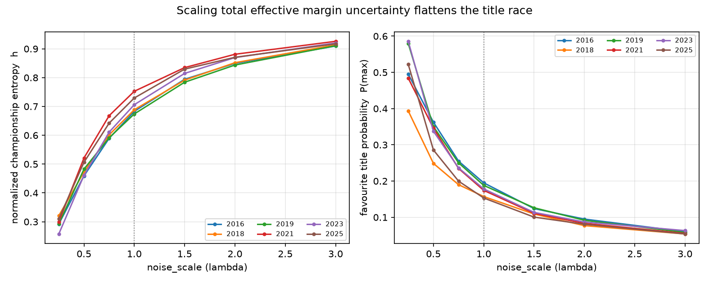
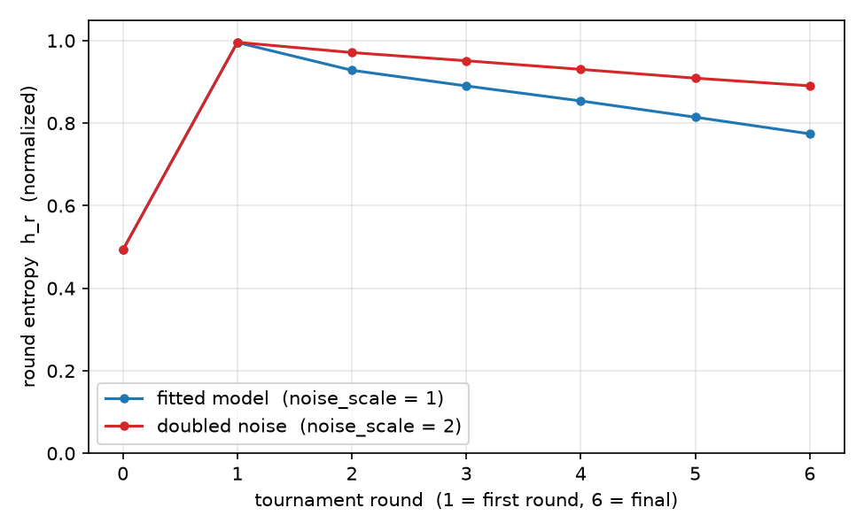

# March Madness Predictor

A probabilistic NCAA tournament simulator: instead of one "correct" bracket, it
produces **calibrated probabilities** — `P(team wins it all)`, `P(team wins this
game)`, and `P(team reaches the Elite Eight)` — and checks them with a
walk-forward backtest against baselines that are deliberately hard to beat.

**Highlights**

- **Probabilities, not picks.** Every simulation returns a full title
  distribution, per-round survival probabilities, and uncertainty estimates.
- **Transparent model.** A hierarchical Gaussian margin model fit with a dyadic
  ridge regression. Only NumPy and pandas — no black-box ML framework.
- **Honest evaluation.** Four held-out tournaments, log loss / Brier / reliability
  tables, and a seed-only baseline that beats the full model on three of four
  metrics. The negative result is reported, not hidden.
- **Tested.** 367 pytest tests, clean `ruff` and `mypy --strict`.

## At a glance

| | |
| --- | --- |
| Data | Kaggle [March Machine Learning Mania 2026](https://www.kaggle.com/competitions/march-machine-learning-mania-2026), men's results 2003–2025 (latest season in the bundle) |
| Model | Elo-anchored dyadic ridge fit → team strength + volatility → Gaussian matchup probabilities |
| Simulation | Monte Carlo over the real seed/slot bracket, with one latent form draw per team per tournament |
| Evaluation | Walk-forward 2022–2025 vs uniform, coin-flip, and seed-only baselines |
| Outputs | Title/win/reach probabilities, championship entropy, effective number of contenders, reliability tables |
| Dependencies | `numpy`, `pandas` (dev: `pytest`, `ruff`, `mypy`) |

## What it does

Give it a season and it walks the actual 68-team bracket, one simulated game at
a time. From the walk-forward backtest (fit on 2003–2024, 4,000 sims), 2025 looks
like this:

```
2025: fitting on 2003-2024
  champion Florida (model 4.0%, top pick Duke at 14.3%)
  field    Duke 14.3%, Kansas 12.5%, North Carolina 8.8%, Gonzaga 7.7%, Michigan St 6.0%
```

The interesting output is the shape of the field, not the top line: a 14% favourite
in a 68-team tournament is a wide-open race. The project's real target is
**whether those numbers are right**, so the backtest — not the bracket — is the
centrepiece.

## How it works

```mermaid
flowchart LR
    A[Kaggle CSVs] --> B[data_loader.py<br/>sequential Elo + volatility features]
    B --> C[calibration.py<br/>dyadic ridge fit<br/>strength, sigma, phi]
    C --> D[matchup.py<br/>P(i beats j) = Phi(mu / tau)]
    D --> E[bracket.py<br/>seed + slot graph]
    E --> F[simulate.py<br/>Monte Carlo + observables]
    F --> G[backtest.py<br/>log loss / Brier / reliability]
    F --> H[results/<br/>tables + figures]
```

1. **Ingest** (`src/data_loader.py`). Build each team's state from regular-season
   games: a sequential Elo rating, three-point attempt rate (`p3ar`), and the
   variance of per-game offensive efficiency.
2. **Fit** (`src/calibration.py`). A dyadic ridge regression on game margins,
   anchored to Elo, estimates relative strengths, the Elo-to-points conversion,
   home-court advantage, and per-team volatility
   `sigma_i = sigma_0 + alpha * z_p3ar + beta * z_effvar`. A separate estimate of
   the latent fraction `phi` comes from the ratio of between- to within-season
   residual variance.
3. **Match up** (`src/matchup.py`). For teams `i` and `j`, with
   `tau_ij = hypot(sigma_i, sigma_j)`:

   `P(i beats j) = Phi( (Elo_i - Elo_j + HCA) / (elo_per_point * tau_ij) )`

   Elo sets the expected margin; volatility controls how often it can flip. A
   latent strength offset `z_k ~ N(0, phi * sigma_k^2)` is drawn **once per team
   per tournament**, so a hot or cold run carries across rounds instead of
   resetting every game. The split leaves the unconditional variance exactly
   equal to the fitted one — no double counting.
4. **Simulate** (`src/bracket.py`, `src/simulate.py`). The bracket graph is read
   from Kaggle's seeds and slots files; Monte Carlo plays it out and aggregates
   title, win, and per-round reach probabilities. It also reports championship
   entropy `H = -sum p_i ln p_i`, normalized `h = H / ln 68`, concentration
   (`P(max)`, `P(top 3)`, Herfindahl `C`, `N_eff = 1/C`) and round entropy. Twenty
   independent batches give a Monte Carlo standard error for every observable;
   batching only *counts* draws, so changing the batch count never changes the
   simulation.
5. **Score** (`src/backtest.py`, `tools/backtest.py`). Each evaluation season is
   predicted from earlier seasons only — no leakage — then scored with title log
   loss, per-game win log loss, advancement and reach Brier, plus reliability
   tables split by round.

Implementation details that make the comparisons trustworthy: `Phi` is computed
in closed form with `math.erf` (no SciPy dependency), the noise sweep uses common
random numbers so every grid point sees the same draws, and `noise_scale = 1` is
bit-identical to the fitted model.

## Evaluation

Walk-forward, 2022–2025, 4,000 sims per season, seed 0. 2021 is skipped because
its source file has 66 games where a complete 68-team field needs 67. Full raw
output: [`results/backtest.txt`](results/backtest.txt).

Lower is better. **Seed-only** is a one-feature logistic regression on seed
difference, historical seed shares for titles (Laplace-smoothed), and per-seed
advancement/reach rates — all fit on the same earlier seasons
(`src/baselines.py`).

| Metric | Model | Seed-only | Trivial baseline |
| --- | ---: | ---: | ---: |
| Title log loss | 3.115 | **3.004** | 4.220 (uniform over 68) |
| Win log loss | **0.616** | 0.630 | 0.693 (coin flip) |
| Advancement Brier | 0.2344 | **0.1925** | 0.2500 (constant 0.5) |
| Reach Brier | 0.0835 | **0.0806** | per-round base rate |

The honest reading: the model beats a uniform field by 26% on title log loss,
but the seed-only baseline wins three of four metrics. Most of that apparent
edge was the seeding already fed into the model. The one place the extra
machinery helps is per-game win probability, and only slightly.

| Season | Champion (model probability) | Model's top pick | Title log loss |
| --- | --- | --- | ---: |
| 2022 | Kansas (14.5%) | Duke (15.0%) | 1.928 |
| 2023 | Connecticut (1.7%) | Duke (17.3%) | 4.075 |
| 2024 | Connecticut (3.9%) | Duke (15.3%) | 3.251 |
| 2025 | Florida (4.0%) | Duke (14.3%) | 3.206 |

Reliability is where the signal lives. Early rounds beat the coin-flip baseline
(win log loss 0.571 over 192 games, Brier 0.1963 vs 0.25); rounds 3–6 do not
(0.757 over 60 games). Four tournaments is a first look, not a general
calibration claim — which is why the backtest reports bands and standard errors
rather than one flattering number.

## Experiments

### How uncertain should the field be?

`noise_scale` divides only the *deterministic* margin (Elo gap plus site effect),
leaving the latent drift and volatility scale untouched. The random draws are
therefore identical across the grid (common random numbers), so the effect is
cleanly monotone. Six seasons × 4,000 sims:



For 2025, the fitted model (`noise_scale = 1`) sits at normalized championship
entropy `h = 0.73`, favourite `P(max) = 15%`, and `N_eff = 14.3`:

| `noise_scale` | 0.25 | 0.5 | 0.75 | 1.0 | 1.5 | 2.0 | 3.0 |
| ---: | ---: | ---: | ---: | ---: | ---: | ---: | ---: |
| `h` | 0.31 | 0.51 | 0.64 | 0.73 | 0.83 | 0.87 | 0.92 |
| `P(max)` | 52% | 29% | 20% | 15% | 10% | 8% | 5% |
| `N_eff` | 2.8 | 5.9 | 9.8 | 14.3 | 24.1 | 30.8 | 40.6 |

Round entropy shows *where* that uncertainty sits: round 1 is already nearly
maximal, so the knob mostly changes who survives the late rounds.



Reproduce: `python tools/noise_sweep.py --sims 10000`.

### Recency weighting: tried and rejected

An all-history fit tracks seeding closely (Spearman ~0.82) but current Elo
weakly (~0.15), so recent-form weighting looked like an obvious fix. It improved
every dev season (title log loss 2.993 → 2.579 at a two-season half-life) and
the dev curve was monotone to the grid edge — a warning sign. On held-out
2022–2025 it made the headline metric **worse**:

| Model | Title log loss | Win log loss |
| --- | ---: | ---: |
| `inf` half-life, latent on (shipped) | **3.115** | 0.616 |
| `H = 2`, latent on | 3.892 | 0.599 |

The default remains the plain all-history model. Reproduce with
`python tools/recency_experiment.py select` and
`python tools/recency_experiment.py evaluate --half-life 2`.

## Run it locally

```bash
git clone https://github.com/lakshchatt04-spec/march-madness-predictor.git
cd march-madness-predictor
pip install -e ".[dev]"
```

Download the Kaggle competition data and place the
`march-machine-learning-mania-2026/` folder in the repo root or any parent
directory (the tools search upwards for it).

```bash
# Simulate one season's bracket
python tools/simulate_season.py --season 2025 --sims 20000

# Walk-forward backtest with the seed-only comparison
python tools/backtest.py --seasons 2022 2023 2024 2025 --baseline
```

Checks:

```bash
pytest          # 367 tests
ruff check .
mypy
```

## Layout

| Path | What it is |
| --- | --- |
| `src/data_loader.py` | CSV ingestion and feature engineering |
| `src/models.py` | `ParticleTeam` state and volatility parameters |
| `src/calibration.py` | dyadic ridge fit, latent-fraction estimate |
| `src/matchup.py` | win probability, venue effects, latent strength draws |
| `src/bracket.py` | bracket graph from seeds/slots |
| `src/simulate.py` | Monte Carlo runner and ensemble observables |
| `src/backtest.py` | scoring metrics and ground truth |
| `src/baselines.py` | seed-only baseline for comparison |
| `tools/` | CLIs: simulate, backtest, noise sweep, recency experiment, diagnostics |
| `tests/` | pytest suite |
| `results/` | committed backtest output, CSV, and figures |

## What I learned

- An improvement that only exists on the seasons used to choose it is not
  evidence. The recency sweep looked perfect in-sample and failed out of sample;
  its optimum sitting on the grid edge was the tell.
- A strong baseline is more informative than a flattering one. Building the
  seed-only forecast showed that most of the model's advantage over uniform was
  just the seeding, and made the evaluation worth reading.
- A probability forecast is a calibration problem, not a picking contest.
  Entropy, reliability tables and Monte Carlo standard errors say more than a
  bracket that happened to win.

## Limitations

- Only four tournaments are scored, so the metric estimates are noisy; the fit
  uses 20+ seasons, but that does not make the held-out sample larger.
- Team strength is pooled and recency-agnostic — closer to a prestige ranking
  than current form. Recency weighting was tried and rejected above.
- The latent-strength term is unproven: turning it off scored slightly better on
  title log loss over the same four seasons. A lead to check, not a result.
- The seed-only baseline is not clearly beaten; the full model's gap over a
  uniform field is mostly the seeding in it.
